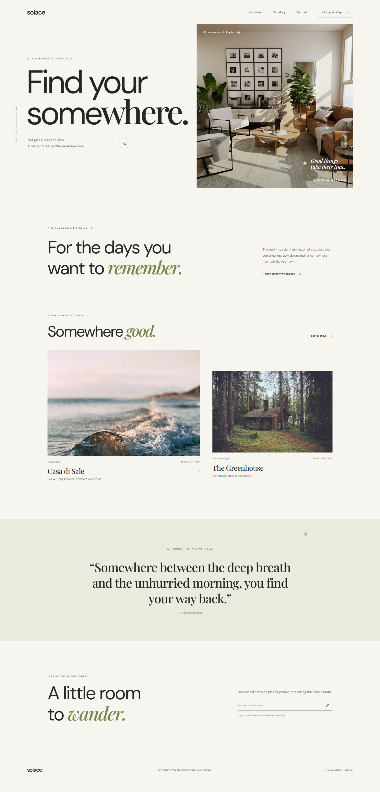

# Solace — Find your somewhere

Solace is a responsive, editorial-style landing page for a fictional collection of considered travel stays. Its calm palette, generous spacing, serif accents, and destination photography are designed to make browsing feel a little like slowing down.

The site is built with plain HTML, CSS, and JavaScript. It has no application framework, build step, or project dependencies.

## Preview

The screenshot shows the complete desktop page, from the navigation and hero through the featured stays, editorial quote, newsletter form, and footer.

## Run locally

1. Download or open this project folder.
2. Open `index.html` in a modern web browser.

For local development, you can also open the folder in Visual Studio Code and use a static-server extension such as Live Server. If Node.js is installed, run `npx serve .` from the project folder and visit the local address printed in the terminal.

Google Fonts and the Unsplash photographs are loaded from external URLs. An internet connection is required to load these assets; the page content and styles remain in the local project.

## Project files

| File | Description |
| --- | --- |
| `index.html` | Semantic page content, navigation, destination cards, and newsletter form |
| `styles.css` | Colors, typography, layouts, hover states, animation, and responsive breakpoints |
| `script.js` | Mobile navigation toggle and client-side newsletter form response |
| `screenshot.png` | Full-page desktop screenshot of the finished landing page |

## Page sections

- **Navigation:** Solace wordmark, links to the page sections, and a call-to-action link.
- **Hero:** Oversized “Find your somewhere” headline, destination photography, and a link to explore the stays.
- **Introduction:** A short statement about slowing down and choosing more thoughtful trips.
- **Featured stays:** Two destination cards with location, nightly price, and a short description.
- **Editorial quote:** A quiet interlude between the featured stays and newsletter.
- **Newsletter:** An email input with native email validation and a submission confirmation.
- **Footer:** The Solace wordmark and a short brand sign-off.

## Interactions and accessibility

- On narrow screens, the **Menu** button opens and closes the navigation. Its `aria-expanded` value reflects whether the menu is open, and selecting a navigation link closes it.
- The newsletter form checks that the entered address is a valid email format and displays an on-page confirmation. This is a front-end demonstration: it does not subscribe, send, or store email addresses.
- The hero photograph appears with a brief entrance animation. Motion-sensitive visitors are accommodated with the `prefers-reduced-motion` media query.
- The page uses semantic landmarks and headings, accessible names for interactive controls, alternative descriptions for destination imagery, and an announcement region for the form response.
- Layout breakpoints adapt the navigation, hero, destination cards, and footer for mobile, tablet, and desktop screens.

## Customization

- Update the copy, section labels, navigation, and featured stay details in `index.html`.
- Adjust the palette and typefaces in the CSS custom properties at the beginning of `styles.css`.
- Replace the external image URLs in `styles.css` to change the hero and destination photography. Update the corresponding image descriptions in `index.html` when an image's subject changes.
- Connect the newsletter form in `script.js` to a newsletter service if real subscriptions are needed. The current confirmation is intentionally local-only.

## Built with

- HTML5
- CSS3
- Vanilla JavaScript
- DM Sans and Playfair Display, served by Google Fonts
- Destination photography, served by Unsplash
